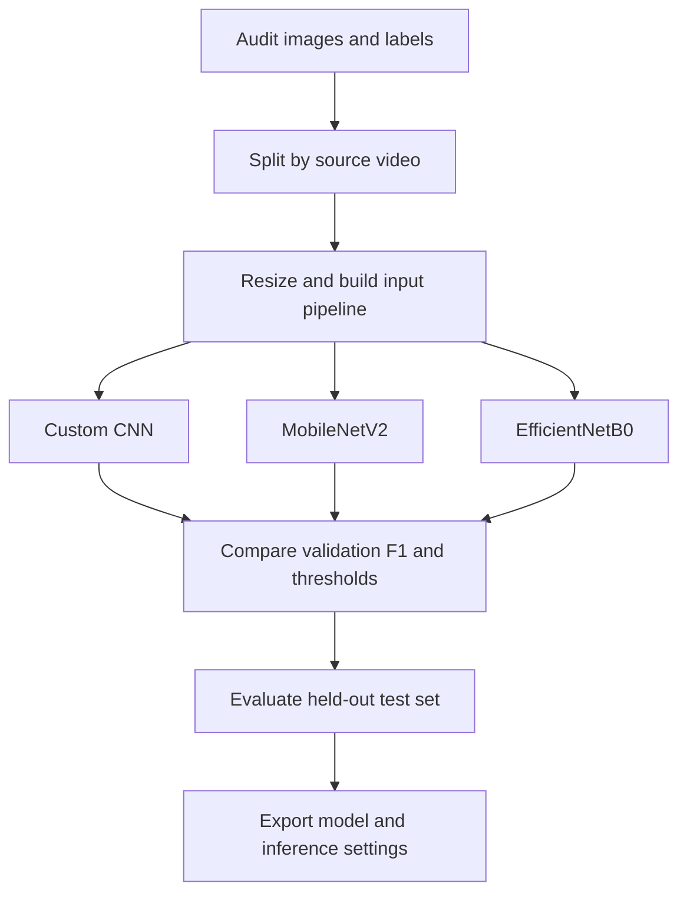

# MonReader | Page-Flip Detection with Deep Learning

**A Python computer vision project completed during my Apziva AI Residency.**

I developed an image-classification workflow to distinguish a page being flipped from a stationary page. The project compares a custom CNN with pretrained MobileNetV2 and EfficientNetB0 models, selects a decision threshold using validation F1, and evaluates the selected model on images from held-out source videos.

**Recorded test results:** **92.61% page-flip F1** · **92.88% accuracy** · **0.9804 ROC-AUC**

## Project Overview

Document digitization systems need to recognize page transitions before selecting images for capture. MonReader's broader use case is accessible, automatic document scanning for readers, researchers, and people with visual impairments.

This project implements the **page-flip classification component**: given one RGB image, predict `notflip` or `flip`. Document cropping, dewarping, OCR, mobile integration, and real-time sequence detection are outside the implemented scope.

| Item | Approach |
|---|---|
| Task | Binary image classification |
| Labels | `notflip = 0`, `flip = 1` |
| Primary metric | F1 for the page-flip class |
| Selected model | Fine-tuned EfficientNetB0 |
| Decision threshold | 0.52, selected on validation data |
| Framework | Python, TensorFlow and Keras |
| Main implementation | [MonReader.ipynb](MonReader.ipynb) |

## My Contribution

I implemented the workflow from dataset auditing through model export:

- Built an image inventory with labels, source-video IDs, frame numbers, image dimensions, and decoded-pixel hashes.
- Added checks for unreadable images, ambiguous class folders, conflicting labels, and leakage between partitions.
- Created source-video-disjoint training, validation, and test partitions to keep frames from the same recording together.
- Implemented a TensorFlow input pipeline with training augmentation, batching, prefetching, and model-specific normalization.
- Compared a CNN baseline with frozen and fine-tuned transfer-learning models.
- Selected the model and threshold using validation F1, then evaluated the held-out test set.
- Exported model checkpoints, inference settings, split manifests, predictions, and performance summaries.

## Dataset and Evaluation Design

The recorded dataset audit contains **2,989 readable images** from **65 parsed video IDs**, with image dimensions of **1080 × 1920**. No exact decoded-pixel duplicates were reported.

| Partition | Images | Source-video IDs | Page-flip proportion |
|---|---:|---:|---:|
| Training | 1,798 | 39 | 48.4% |
| Validation | 601 | 13 | 48.8% |
| Test | 590 | 13 | 48.8% |

**Split disclosure:** The submitted configuration uses `PRESERVE_OFFICIAL_TEST = False`. It pools the scanned images and creates a new grouped split, rather than retaining the dataset's supplied testing folder. Reported scores therefore describe this grouped evaluation, not the original supplied test split.

Source-video IDs are parsed from filenames ending in `VideoID_FrameNumber`. The grouping assumes these IDs identify independent original recordings; reused IDs or clips from a shared source require a corrected mapping. Exact-duplicate checks complement this grouping, while visual near-duplicates still need review.

## Step-by-Step Workflow



### 1. Validate the Image Collection

Scan class folders recursively, decode images, and inspect dimensions and class balance. Unrecognized labels and conflicting labels for identical pixels stop execution; unreadable images are reported and excluded.

### 2. Create Grouped Partitions

Use `GroupShuffleSplit` to keep each parsed source-video ID within one partition. Candidate splits are compared using partition size and class balance, without using model performance. Assertions check both video-ID overlap and exact-pixel overlap.

### 3. Prepare Model Inputs

Decode images as RGB and resize them to **224 × 224**. Training images are shuffled and augmented with small rotations, zoom, and contrast changes. Validation and test order remain fixed to keep predictions aligned with image records.

Normalization is inside each model: the CNN scales pixels to `[0, 1]`, MobileNetV2 to `[-1, 1]`, and EfficientNetB0 uses its built-in preprocessing. Inputs to the pipeline remain in `[0, 255]`.

### 4. Train and Compare Models

The custom CNN uses three convolution/pooling blocks with 32, 64, and 128 filters, followed by global average pooling, dropout, and a sigmoid classifier.

Transfer learning starts with ImageNet-pretrained backbones and trains a classification head while the backbone is frozen. Fine-tuning then unfreezes the final 30 backbone layers, keeps batch-normalization layers frozen, and uses a smaller learning rate. Class weights, early stopping, and learning-rate reduction support training.

### 5. Select the Model and Decision Threshold

Evaluate thresholds from **0.05 to 0.95** in steps of **0.01** using validation page-flip F1. Threshold ties prefer values closest to 0.50; model ties prefer the smaller saved checkpoint.

| Candidate | Selected threshold | Validation flip F1 |
|---|---:|---:|
| **EfficientNetB0 — fine-tuned** | **0.52** | **91.07%** |
| EfficientNetB0 — frozen backbone | 0.41 | 89.23% |
| MobileNetV2 — fine-tuned | 0.35 | 83.55% |
| MobileNetV2 — frozen backbone | 0.40 | 79.05% |
| Custom CNN | 0.31 | 75.99% |

Fine-tuned EfficientNetB0 improved validation F1 by **15.07 percentage points** over the CNN baseline. These validation scores support model selection; the following test scores provide the held-out evaluation.

### 6. Evaluate the Selected Model

| Test metric | Recorded result |
|---|---:|
| Page-flip F1 | **92.61%** |
| Page-flip precision | **93.93%** |
| Page-flip recall | **91.32%** |
| Overall accuracy | **92.88%** |
| ROC-AUC | **0.9804** |
| Test images | **590** |

At threshold **0.52**, the model correctly identifies **263 of 288** flipping images, misses **25** flips, and incorrectly labels **17 of 302** non-flipping images as flips. The notebook includes a classification report, confusion matrix, ROC curve, and examples of misclassified images.

These results are taken from the saved notebook outputs. They demonstrate image-classification performance on this split; they do not establish mobile latency or performance on new cameras and environments.

### 7. Export and Run Inference

The notebook saves the selected model and its matching threshold/configuration. Its `predict_image()` helper returns a predicted label and sigmoid page-flip score for a new image.

## Run the Project

1. Download or clone this repository and open a terminal in its root folder.
2. Create and activate a Python environment, then install the required packages:

   ```bash
   python -m venv .venv
   # Windows:
   .venv\Scripts\activate
   # macOS/Linux:
   # source .venv/bin/activate
   python -m pip install tensorflow pandas numpy scikit-learn matplotlib pillow jupyter
   ```

3. Obtain the project dataset separately and extract it under `data1/`. The notebook recognizes `flip`, `flipping`, `notflip`, and `notflipping` class folders and scans recursively. Use filenames such as `0001_0020.jpg`, with the source-video ID before the final underscore.
4. Launch `jupyter notebook`, open `MonReader.ipynb`, and verify `DATA_DIR`, `PRESERVE_OFFICIAL_TEST`, and `RUN_TRANSFER` in the configuration cell.
5. Run the notebook from top to bottom. Transfer-learning weights require an internet connection on first use. Training creates `monreader_outputs/`.
6. After training, call `predict_image("path/to/new_image.jpg")` in the notebook to classify a new image using the selected model and threshold.

The recorded run used **Python 3.13.9** and **TensorFlow 2.21.0** on CPU. The install command lists dependencies rather than pinning a fully reproduced environment. Dataset images and trained model files are not bundled with this README.

## Generated Artifacts

| Output | Purpose |
|---|---|
| `train_manifest.csv`, `validation_manifest.csv`, `test_manifest.csv` | Records of the split used in the run |
| Candidate `.keras` files | Saved CNN and transfer-learning checkpoints |
| `validation_comparison.csv` | Model comparison and selected thresholds |
| `best_model.keras` | Selected model with preprocessing included |
| `inference_config.json` | Threshold, labels, image size, seed, and TensorFlow version |
| `test_predictions.csv` | Image-level scores and predicted labels |
| `test_metrics.json` | Final test metrics, including ROC-AUC |
| `test_roc_curve.png` | Saved ROC visualization |

## Limitations and Next Steps

- **Generalization:** Evaluate on additional independent recordings, devices, lighting conditions, and document types.
- **Split reliability:** Confirm parsed IDs match original recordings and inspect near-duplicates before extending the dataset.
- **Validation reuse:** Model and threshold selection share one validation set; grouped cross-validation would give a broader estimate of variability.
- **Temporal behavior:** The implemented classifier processes individual images. Sequence-level detection and temporal smoothing remain future work.
- **Deployment:** Measure latency and memory, then assess quantization or a smaller backbone for mobile use. Mobile integration is not implemented here.

## Conclusion

This project demonstrates my ability to connect a practical computer vision problem with data validation, transfer learning, threshold selection, and transparent evaluation. Fine-tuned EfficientNetB0 achieved **92.61% page-flip F1** on the held-out grouped test set, while exported artifacts make the selected model and decision rule inspectable.

For hiring managers and recruiters, my contribution spans the complete experimental workflow: auditing source data, addressing frame leakage, comparing model families, interpreting errors, and preparing model outputs for subsequent integration. The next engineering milestone is validating the approach on broader data and measuring its suitability for mobile inference.

**Author:** Anagha C. S.  
**Program:** Apziva AI Residency
